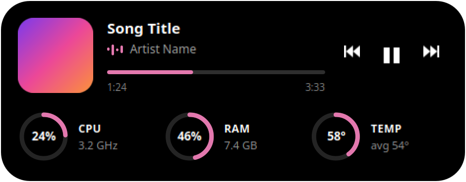

# KDE Dynamic Island

A floating, Dynamic Island-style panel for KDE Plasma 6 on Wayland. It stays hidden until your cursor touches the top of the screen, then springs down to show what's playing and how your PC is doing.



## Features

- Media info from any MPRIS player: album art, title, artist, seekable progress, previous/play/next
- CPU usage and frequency, RAM usage, and CPU temperature
- Colours taken from the album art, turning amber and then red when values get high
- A tray icon to run or quit it
- Written in plain QML and Python using modules already on most Plasma systems, with nothing to compile

## Requirements

- KDE Plasma 6 on Wayland
- The `qml6` runtime with the QtQuick Shapes and Effects modules
- The KDE modules for layer-shell (`layer-shell-qt`), Kirigami and `libksysguard` sensors
- `ksystemstats`, which provides the sensor readings
- Python 3 with `dbus-python` and PyGObject, for the tray icon

Developed and tested only on KDE neon 24.04 with Plasma 6.8 and Qt 6.11. Package names vary between distributions.

## Install

```bash
git clone https://github.com/heditrigui/kde-dynamic-island.git
cd kde-dynamic-island
./install.sh
```

This copies the files into your home folder and enables two systemd user services, the island and its tray icon, which start with your desktop session. It doesn't need root.

To remove it:

```bash
./install.sh --uninstall
```

## Usage

| Action | Result |
|---|---|
| Move the cursor to the top centre of the screen | Opens the island |
| Move the cursor away | Hides it |
| Left click | Pins it open or unpins it |
| Right click | Quits until you start it again or next log in |
| Left click the tray icon | Runs or quits it |
| Right click the tray icon | Opens the Run, Quit and Restart menu |

```bash
systemctl --user status dynamic-island
systemctl --user restart dynamic-island
journalctl --user -u dynamic-island -e
```

## Configuration

Edit the `Tweakables` block at the top of `~/.local/share/dynamic-island/island.qml`, then restart the service. You can change the reveal zone size and delay, the warning thresholds, the fallback colour, and whether the island pops open when the song changes.

## Known limitations

- It appears only on the primary screen.
- Media info uses Plasma's private `org.kde.plasma.private.mpris` module, so a Plasma update could break it.
- While hidden, the island takes clicks on a thin strip at the top centre of the screen (600 × 2 px by default).
- The equaliser is decorative and doesn't react to the audio.

### Snap apps, including Spotify

Snap players can restrict which apps may read their media info through AppArmor. The Spotify snap allows only `plasmashell` and unconfined apps. The service runs unconfined, so it works, but a copy started from a confined app may not see the player.

## License

[MIT](LICENSE). Not affiliated with or endorsed by Apple or KDE.
